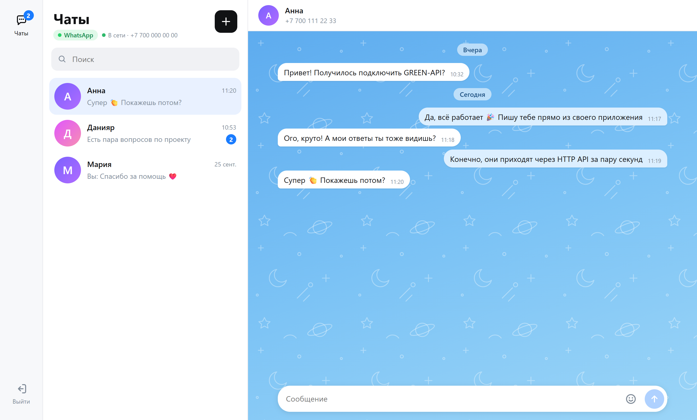
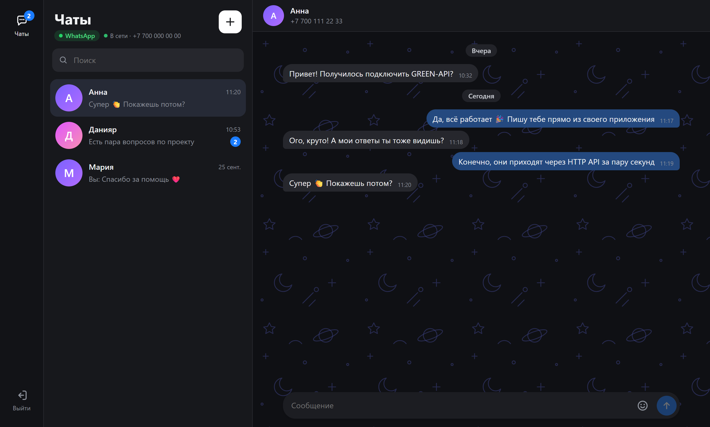
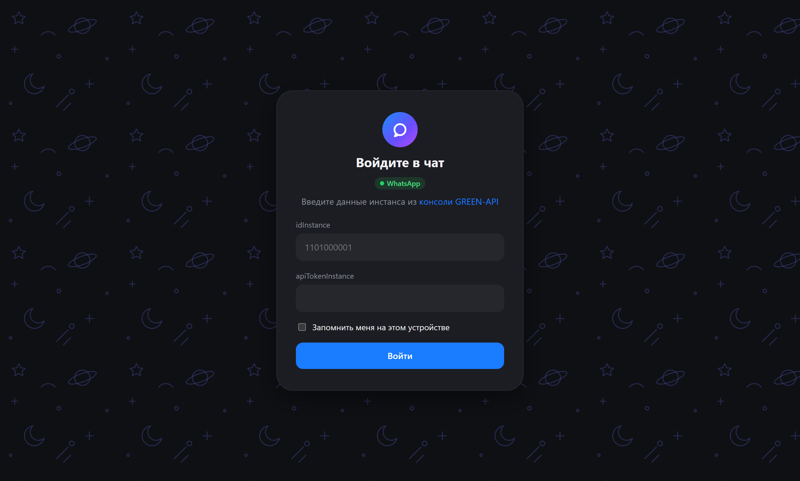
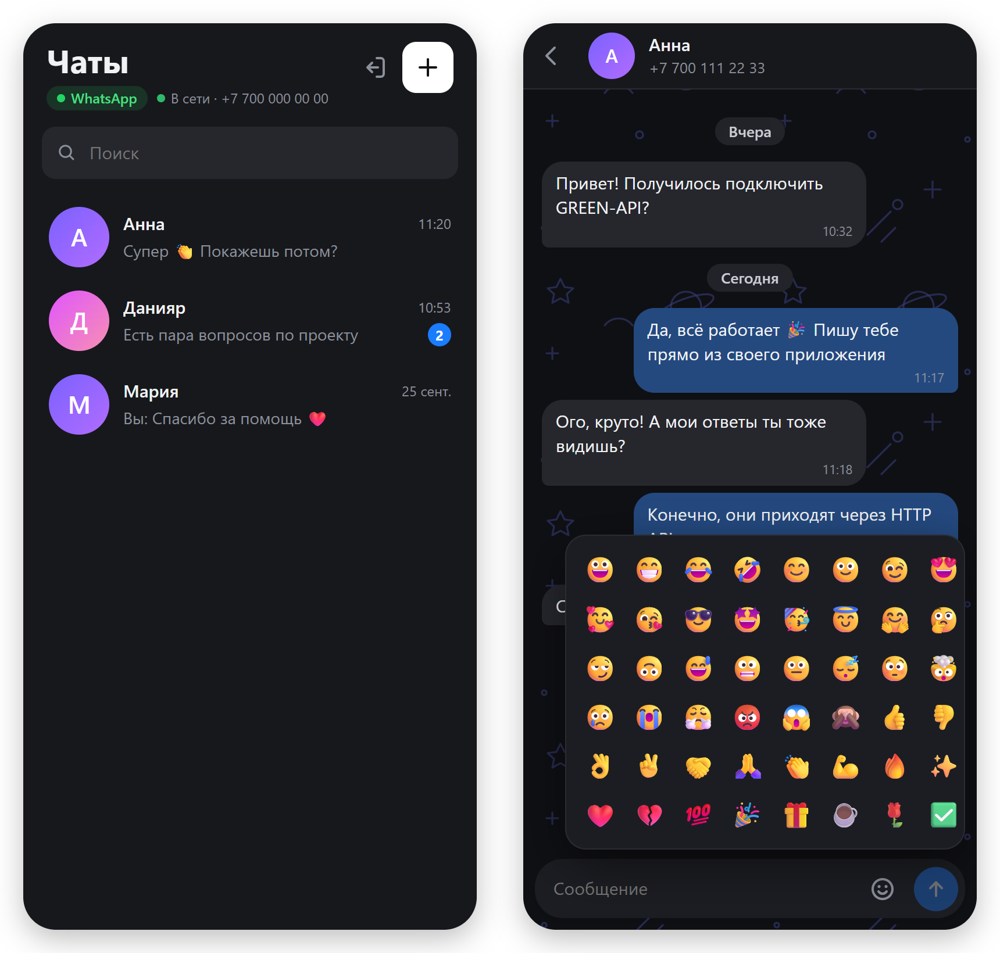

# Green Chat - чат WhatsApp на GREEN-API

Тестовое задание на должность "Фронтенд разработчик React".

Простой веб-интерфейс для отправки и получения текстовых сообщений WhatsApp через [GREEN-API](https://green-api.com/docs/).
За прототип интерфейса взят внешний вид [web.max.ru](https://web.max.ru/).

**Демо:** https://rrre-gina.github.io/green-api-chat/

> **Почему WhatsApp, а не MAX.** Я живу в другой стране, и в MAX у меня нет собеседников, чтобы проверить получение ответов.
> Задание допускает WhatsApp или Telegram. Я выбрала WhatsApp.

## Скриншоты

Светлая и тёмная темы переключаются по настройкам системы.









*На скриншотах вымышленные контакты и номера.*

## Возможности

- Вход по `idInstance` и `apiTokenInstance` с проверкой данных (`getStateInstance`)
- Если инстанс не авторизован, QR-код для привязки WhatsApp показывается прямо в приложении (метод `qr`)
- Создание чата по номеру телефона (с проверкой формата, `8…` автоматически заменяется на `7…`)
- Отправка текстовых сообщений ([SendMessage](https://green-api.com/v3/docs/api/sending/SendMessage/))
- Получение сообщений через [HTTP API](https://green-api.com/v3/docs/api/receiving/technology-http-api/): `ReceiveNotification` → обработка → `DeleteNotification`
- Проверка настроек инстанса: если уведомления о входящих выключены, приложение предлагает включить их одной кнопкой (`setSettings`)
- Поиск по чатам, счётчик непрочитанных, индикатор соединения, разделители по датам
- Панель смайликов, статус отправки сообщения (отправляется / ошибка с кнопкой «Повторить»)
- Адаптивная вёрстка для телефона, светлая и тёмная темы (по настройкам системы)

## Запуск локально

Нужен Node.js 20+.

```bash
npm install
npm run dev
```

Откройте http://localhost:5173.

Другие команды:

```bash
npm test         # юнит-тесты (Vitest)
npm run lint     # линтер (oxlint)
npm run build    # production-сборка в dist/
```

## Как проверить

1. Зарегистрируйтесь в [консоли GREEN-API](https://console.green-api.com) и создайте инстанс WhatsApp (тариф Developer бесплатный).
2. Откройте приложение и введите `idInstance` и `apiTokenInstance`.
3. Если инстанс не авторизован, отсканируйте QR-код в WhatsApp: «Связанные устройства» → «Привязка устройства».
4. Если появилось предупреждение об уведомлениях, нажмите «Включить» (или включите в консоли
   «Получать уведомления о входящих сообщениях и файлах»). Настройки применяются до 5 минут.
5. Нажмите «+», введите номер получателя и отправьте сообщение.
6. Ответ получателя появится в чате.

## Устройство

```
src/
  api/greenApi.ts               — запросы к GREEN-API и обработка ошибок
  hooks/useNotificationPolling  — цикл получения уведомлений с повтором при ошибках
  hooks/useChats                — состояние чатов (useReducer) и сохранение в storage
  utils/notifications.ts        — разбор уведомлений в текстовые сообщения
  utils/phone.ts                — нормализация и форматирование номеров
  components/                   — экран входа, QR, список чатов, окно чата
```

Решения, которые стоит отметить:

- **Уведомление удаляется всегда**, даже если оно не нужно (статус, файл, сообщение из группы).
  Иначе очередь GREEN-API «застрянет» на нём и новые сообщения не придут.
- **Без дублей.** Отправленное сообщение сразу показывается в чате, а пришедшее затем уведомление
  `outgoingAPIMessageReceived` с тем же `idMessage` игнорируется.
- **Показываются только чаты, созданные в приложении.** Сообщения из других личных чатов и групп пропускаются,
  чтобы не выводить всю личную переписку аккаунта.
- **Безопасность данных входа.** Приложение работает без бэкенда, поэтому токен хранится в браузере:
  по умолчанию в `sessionStorage` (до закрытия вкладки), с галочкой «Запомнить меня» в `localStorage`.
  Кнопка «Выйти» удаляет данные входа и историю чатов.
- **Остановка опроса.** Цикл опроса останавливается через `AbortController` при выходе и размонтировании компонента.

## Стек

React 19, TypeScript, Vite, Vitest, oxlint.

UI-библиотеки не используются: экранов немного, а заданный стиль проще сверстать самостоятельно, чем переопределять тему готового кита. Стили лежат рядом с компонентами, цвета заданы CSS-переменными для светлой и тёмной темы.
